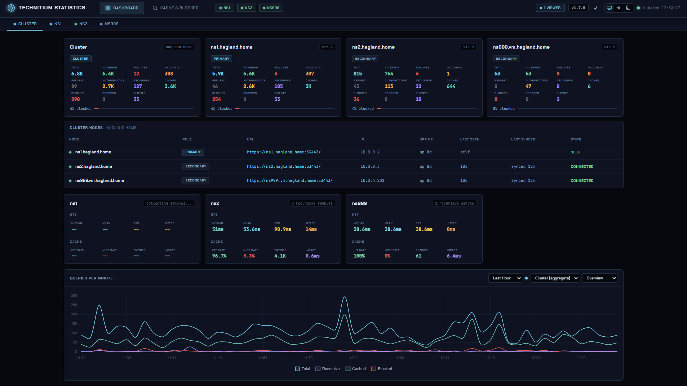
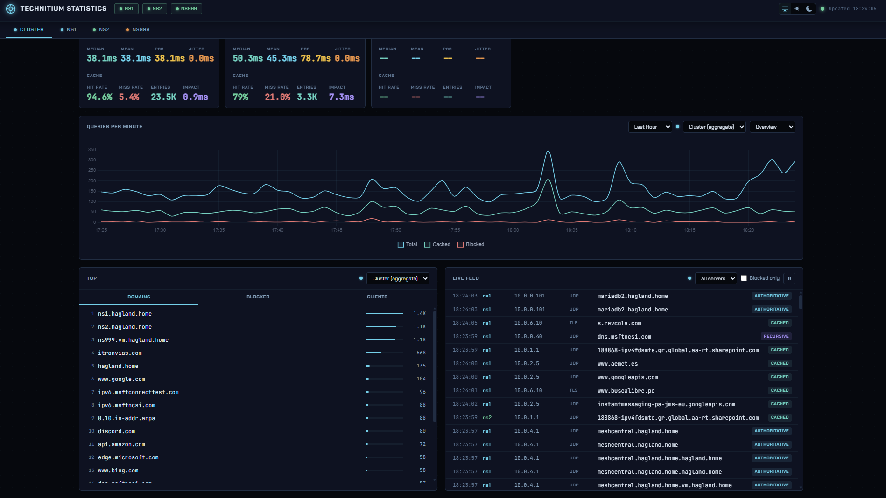
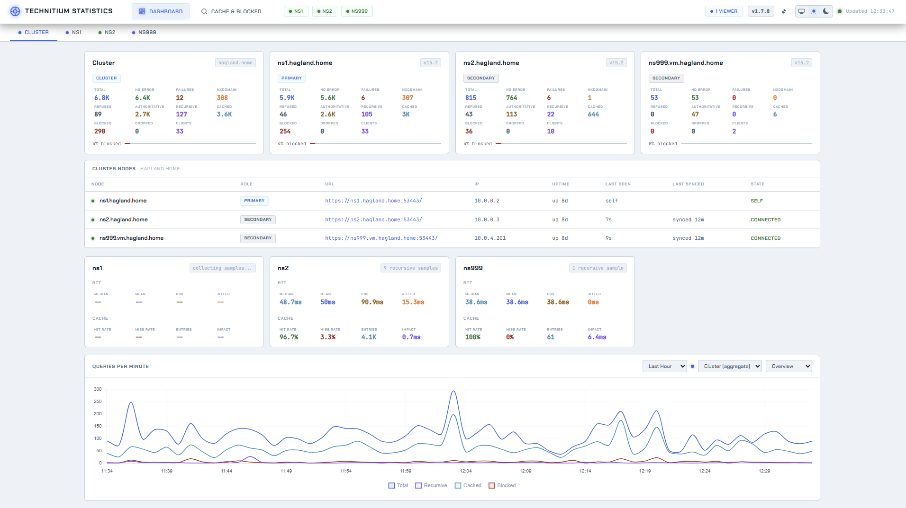
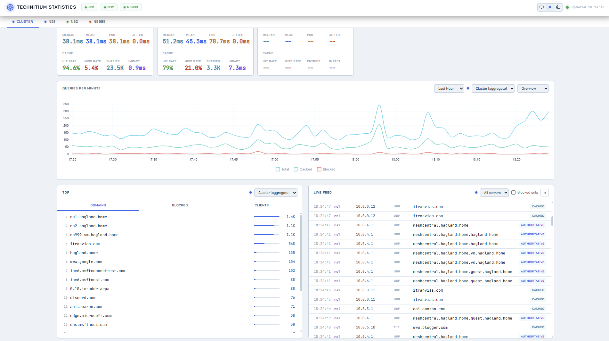

# tdns-stats

[](LICENSE)
[](https://github.com/Hemsby/tdns-stats/releases/latest)

A self-hosted statistics dashboard for [Technitium DNS Server](https://technitium.com/dns/) v15 and later.

Displays live query feeds, per-server and cluster stats, top domains/clients, performance metrics (RTT, cache hit rate), and a real-time chart — all pushed to the browser via Server-Sent Events with no page refreshes required.

See the [CHANGELOG](CHANGELOG.md) for a full history of changes.

## Screenshots

### Dark mode





### Light mode





## Requirements

- Node.js 18 or later
- Technitium DNS Server v15 or later
- A query log app installed on each DNS server (e.g. Query Logs SQLite, MySQL, PostgreSQL) if you want the live feed and RTT metrics

## Running locally

### 1. Clone the repository

```bash
git clone https://github.com/Hemsby/tdns-stats.git
cd tdns-stats
```

### 2. Install dependencies

```bash
cd backend
npm install
cd ..
```

### 3. Configure

```bash
cp config.example.yml config.yml
```

Edit `config.yml` and fill in your server details. At minimum you need the `name`, `url`, and `token` for each server. See `config.example.yml` for all available options with descriptions.

To get your API token: open the Technitium web UI, go to **Administration > Sessions**, and create a token with at least read access.

### 4. Run

```bash
node backend/src/server.js
```

Then open `http://your-host:3000` in a browser.

## Running with Docker

### 1. Clone the repository

```bash
git clone https://github.com/Hemsby/tdns-stats.git /opt/tdns-stats
cd /opt/tdns-stats
```

### 2. Configure

```bash
cp config.example.yml config.yml
# edit config.yml with your server details
```

Before building/starting, if you cloned to a different location than mentioned above, you **must** ensure you update the volume mounts in `docker-compose.yml` to point to the absolute path of the project directory on the host:

```yaml
version: "3"

services:
  tdns-stats:
    build: .
    container_name: tdns-stats
    ports:
      - "3000:3000"
    volumes:
      - <path-to-project>/config.yml:/etc/tdns-stats/config.yml:ro
      - /var/run/docker.sock:/var/run/docker.sock
      - <path-to-project>:/app/host-project
    restart: unless-stopped
```

Replace `<path-to-project>` with the path where you cloned the project to on the host. This mounts the full project directory into the container, which is required for the auto-update feature to rebuild the container using the host compose file.

### 3. Build and Start

```bash
docker compose up -d --build # must be run from inside the project directory
```

The `config.yml` is mounted read-only into the container at `/etc/tdns-stats/config.yml`. To apply config changes, edit the file and run `docker compose restart`.

To build and run without Compose:

```bash
docker build -t tdns-stats .
docker run -d \
  -p 3000:3000 \
  -v $(pwd)/config.yml:/etc/tdns-stats/config.yml:ro \
  --restart unless-stopped \
  tdns-stats
```

> **Note:** Running without Compose disables the auto-update feature, as it requires access to the Docker socket and the full project directory.

## Running as a systemd service

Follow the same instructions for cloning as described above in [Running with Docker](#running-with-docker)

Create `/etc/systemd/system/tdns-stats.service`:

```ini
[Unit]
Description=Technitium DNS Statistics Dashboard
After=network.target

[Service]
Type=simple
WorkingDirectory=/opt/tdns-stats
ExecStart=/usr/bin/node /opt/tdns-stats/backend/src/server.js
Restart=always
RestartSec=5

[Install]
WantedBy=multi-user.target
```

**Important:** Use `Restart=always` (not `on-failure`) to enable the auto-update feature. When updates are triggered, the service exits gracefully and systemd automatically restarts it with the latest code.

Ensure `config.example.yml` is copied to `/etc/tdns-stats/config.yml` (you **must** create this directory if it doesn't exist) and edited with your server details.

Then enable and start the service:

```bash
systemctl daemon-reload
systemctl enable tdns-stats
systemctl start tdns-stats
```

## Auto-Update

The dashboard includes a built-in update checker that works with GitHub releases.

**In the UI:**

- Version number appears in the top-right corner
- Click **Check for updates** to fetch the latest release from GitHub
- If a newer version is available, click **Update** to trigger the update
- The service automatically detects when it comes back online and refreshes the page

**How it works by deployment method:**

| Method  | Mechanism                                                 |
| ------- | --------------------------------------------------------- |
| Docker  | `docker compose pull` + `docker compose up -d --build`    |
| Systemd | `git pull origin master` + `systemctl restart tdns-stats` |

**Requirements by deployment method:**

- **Systemd:** `Restart=always` in the service file (see above)
- **Docker:** Requires two things in `docker-compose.yml`:
  - The Docker socket mounted: `/var/run/docker.sock:/var/run/docker.sock`
  - The full project directory mounted: `/your/path/tdns-stats:/app/host-project`

## Configuration reference

All configuration lives in `config.yml` (see `config.example.yml` for a fully annotated example).

| Key                      | Default       | Description                                                  |
| ------------------------ | ------------- | ------------------------------------------------------------ |
| `port`                   | `3000`        | Port the web interface listens on                            |
| `debug`                  | `false`       | Enable verbose debug logging (see [Debug logging](#debug-logging)) |
| `servers[].name`         | required      | Display name for the server                                  |
| `servers[].url`          | required      | Technitium API base URL (e.g. `http://ns1.example.com:5380`) |
| `servers[].token`        | required      | API token                                                    |
| `servers[].ignoreSsl`    | `false`       | Skip TLS certificate verification                            |
| `servers[].queryLogsApp` | auto-detect   | Name of the query log app on this server                     |
| `servers[].color`        | auto-assigned | Colour for this server in the UI                             |
| `poll.statsInterval`     | `10`          | Seconds between stats refreshes                              |
| `poll.feedInterval`      | `3`           | Seconds between live feed polls                              |
| `poll.topInterval`       | `30`          | Seconds between top-list refreshes                           |
| `poll.perfInterval`      | `30`          | Seconds between RTT/cache samples                            |
| `feed.pageSize`          | `20`          | Log entries fetched per poll cycle                           |
| `feed.maxEntries`        | `200`         | Maximum entries kept in the browser feed                     |
| `top.limit`              | `20`          | Number of items in top domains/clients lists                 |

### Server colours

Available values for `servers[].color`: `blue`, `green`, `ora`, `teal`, `pur`, `yel`, `red`.

If `color` is omitted, servers are auto-assigned colours by their position in the list.

The colour is used to identify each server in the live feed when **All Servers** is selected, where entries from multiple servers are shown together. Each server name in the feed is highlighted in its assigned colour so you can tell at a glance which server handled each query.

### HTTPS

To serve over HTTPS without a reverse proxy, add an `https` block to `config.yml`:

```yaml
https:
  cert: /etc/ssl/certs/tdns-stats.crt
  key: /etc/ssl/private/tdns-stats.key
```

Or using a single combined PEM file (certificate and private key in one file):

```yaml
https:
  pem: /etc/ssl/private/tdns-stats-combined.pem
```

### Cluster support

If your Technitium servers are configured as a cluster, the dashboard automatically detects this and adds a **Cluster** tab showing aggregate stats across all nodes alongside the per-node view.

### Debug logging

Verbose logging is off by default. Enable it with `debug: true` in `config.yml`:

```yaml
debug: true
```

Debug lines are categorised (`[discovery]`, `[feed]`, `[stream]`, `[update]`, ...) so you can filter them easily.

The browser console has its own toggle, independent of the backend setting. Run `Log.enable()` in the devtools console to turn on frontend debug output and `Log.disable()` to turn it off. The choice is stored in `localStorage` and survives reloads.

## Cache & Blocked

The **Cache & Blocked** page shows which servers have a domain in their DNS cache. Tick **Blocked check** to also ask the cluster whether the domain is blocked and by which list.

The check sends a real query to a DNS server (the primary when searching the whole cluster), so it appears in that server's query log and the live feed as a blocked query from `127.0.0.1`. For built-in block lists Technitium must have **Allow TXT Blocking Report** enabled, otherwise a blocked name shows as not blocked, and the result says when the setting is off. Built-in lists report every matching list. The Advanced Blocking App reports only the first one. Secrets in block list URLs (token, key, secret, and password values, and embedded credentials) are hidden.

## Live feed

The live feed requires a query log app to be installed on each DNS server. Supported apps include:

- Query Logs (SQLite)
- Query Logs (MySQL)
- Query Logs (PostgreSQL)
- Query Logs (SQL Server)

If you have more than one query log app installed, specify which one to use with `servers[].queryLogsApp`. Otherwise the first one found is used automatically.

### Filtering the feed

Click a row in **Top Stats**, or a domain or client in the **Live Feed**, to filter the feed. Selections from different Top Stats tabs can be combined (e.g. a specific domain from a specific client). Ctrl/Cmd+click (long-press on mobile) toggles individual Top Stats rows and Shift+click selects a range; active filters appear as chips above the feed and can be removed individually or with **Clear All**.

A domain / client value in the feed can be filtered even if it's not in Top Stats; the Top Stats selected count only includes filters which are present there.

Filters only apply to entries already in the live feed, not the entire count shown by the Top Stats window, so a selected domain can show "No feed entries match the selected filters" until a matching query arrives.

### Tuning the feed polling rate

By default the backend polls every 3 seconds and asks Technitium for the 20 newest query log entries each cycle. Technitium returns only the top-N entries per request, so any queries that land faster than `pageSize / feedInterval` (about 6.7 qps with the defaults) overflow the request and are skipped that cycle.

If your environment produces higher sustained rates or bursty peaks (e.g. an office first thing in the morning), increase `feed.pageSize` so the dashboard can keep up. There is no automatic tuning - raise the value if you notice entries missing from the feed, or if you see frequent `feed cursor reset` lines in the tdns-stats logs. Each Technitium query log app has a per-request cap, so profile before setting it to the maximum.

## Themes

The dashboard supports light, dark, and system themes. The preference is stored in the browser and applied on next load with no flash of unstyled content.
